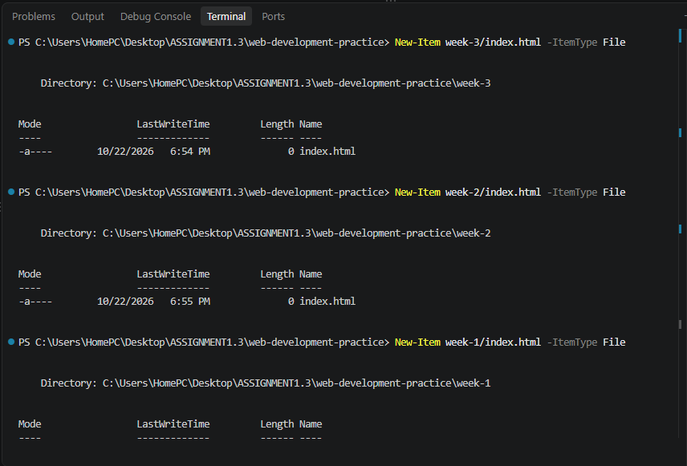

Here’s how to complete Assignment 1.3 — Terminal & Developer Workflow step by step. You can use the commands below in your terminal and include them in your submission.

## 1. Create the project folder structure

# Create the main project folder
mkdir web-development-practice


# Navigate into the project folder
cd web-development-practice

# Create the three week folders
mkdir week-1 week-2 week-3


# Create index.html inside each folder



## 2. Practice terminal navigation, renaming, and deleting

# Display your current directory
pwd

# List files and folders
ls

# Navigate into week-1
cd week-1

# Go back to the main project folder
cd ..

# Rename a practice folder
mv week-3 week-3-renamed

# Rename it back to the original name
mv week-3-renamed week-3

# Create and delete a temporary practice folder
mkdir practice-folder
rmdir practice-folder


# Display the folder list


# Display the final folder structure

tree /F


## 3. Open the project in VS Code
code .
```
This opens the current project folder in Visual Studio Code, provided the `code` command is installed and configured.

open project in vs code.png


